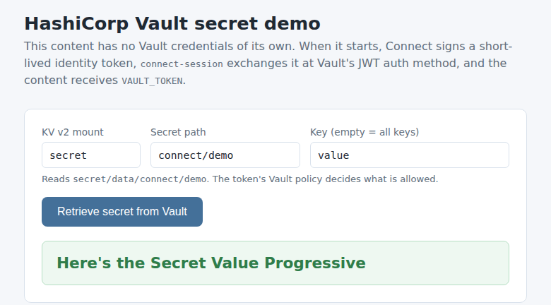

# vault-demo

A small FastAPI app that shows Posit Connect's
[HashiCorp Vault integration](https://docs.posit.co/connect/admin/integrations/oauth-integrations/vault/):
content reads a Vault secret with no Vault credentials of its own.

When the content process starts, Connect signs a short-lived identity token
(`aud=vault`), the Connect content supervisor (`connect-session`) exchanges it at
Vault's JWT auth method, and the process receives `VAULT_ADDR` and `VAULT_TOKEN`.

| Route | What it does |
|---|---|
| `/` | Demo page: pick a KV v2 mount, secret path, and key, then **Retrieve secret from Vault**. Shows the value plus where it came from (path, version, token policies, token TTL). A path outside the token's policy shows Vault's denial. |
| `/secret?mount=&path=&key=` | JSON behind the button. Each parameter defaults to the values below; an empty `key` returns every key at the path. |
| `/status` | Diagnostics: the Vault-related environment (token redacted), the admin guide's `hvac` example run verbatim, and `lookup-self` on the token. |

Tested with Connect 2026.10.0 and Vault 2.2.2.



### Defaults

The form's starting values come from content environment variables (Connect: **Settings > Vars**):

| Variable | Default |
|---|---|
| `DEMO_SECRET_MOUNT` | `secret` |
| `DEMO_SECRET_PATH` | `connect/demo` |
| `DEMO_SECRET_KEY` | `value` |

Mount and path accept `/`-separated segments of letters, digits, `_`, `-`, and `.`
(no `.` or `..` segments). The Vault policy on the Connect role is the real boundary: the app can
read only what `posit-connect-secrets` allows (`secret/data/connect/*` with `setup-vault.sh`).

## Set up

### 1. Vault

Needs the `vault` CLI, `VAULT_ADDR`, and an admin `VAULT_TOKEN`.
Vault must be able to reach Connect's OIDC discovery document.

```bash
CONNECT_SERVER_ADDRESS=https://connect.example.org/ ./vault/setup-vault.sh
```

`CONNECT_SERVER_ADDRESS` must equal Connect's `iss` claim: `IdentityProvider.Issuer` if set,
otherwise `Server.Address` **with** its trailing slash.

The script enables a KV v2 mount at `secret/` and a JWT auth method at `jwt-posit-connect/`,
writes the `posit-connect-secrets` policy and the `connect` role (24h tokens), and writes the
demo secrets if they don't exist yet. It is safe to re-run.

Optional, for showing the config in the Vault UI without the root token:

```bash
REVIEWER_PASSWORD='...' ./vault/reviewer-login.sh
```

This creates userpass user `reviewer`: read-only everywhere, and able to edit
`secret/connect/demo` so a demo can change the value live.

### 2. Connect integration

Needs an administrator API key.

```bash
CONNECT_SERVER=https://connect.example.org CONNECT_API_KEY=... \
VAULT_ADDR=https://vault.example.org ./connect/create-integration.sh
```

Set `VAULT_NAMESPACE` when your Vault uses namespaces (`admin` on HCP Vault Dedicated).

### 3. Deploy the content

```bash
rsconnect deploy fastapi -x docs --title "Vault secret demo" .
```

Or deploy from Git: `manifest.json` is committed.
Then, in the content's **Settings > Runtime > Integrations**, add the Vault integration
(or pass `CONTENT_GUID` to `create-integration.sh`). Changing a content's integrations stops its
running processes; the next request starts one with `VAULT_TOKEN`.

## Two integrations, two roles

Each Connect Vault integration names one Vault role, and each role carries its own policy, so content
gets exactly the permissions of the integration attached to it. To show it, run the setup a second
time for a second role, create a second integration, and deploy the app twice:

```bash
# Vault: role connect-finance, accepting only sub=connect-finance, may read secret/finance/* only.
CONNECT_SERVER_ADDRESS=https://connect.example.org/ CONNECT_SUBJECT=connect-finance \
  CONNECT_POLICY=posit-connect-finance SECRET_PREFIX=finance \
  DEMO_VALUE="Finance-only Secret Value 5678" ./vault/setup-vault.sh

# Deploy a second copy of the app whose form defaults to finance/demo.
rsconnect deploy fastapi --new -x docs --title "Vault secret demo (finance role)" \
  -E DEMO_SECRET_PATH=finance/demo .

# Connect: a second integration for that role and subject, attached to the second copy.
NAME="Vault (finance role)" ROLE=connect-finance SUBJECT=connect-finance CONTENT_GUID=<guid> \
  CONNECT_SERVER=https://connect.example.org CONNECT_API_KEY=... \
  VAULT_ADDR=https://vault.example.org ./connect/create-integration.sh
```

Result (Connect 2026.10.0, Vault 2.2.2):

| Content | Integration role | `secret/connect/demo` | `secret/finance/demo` |
|---|---|---|---|
| Vault secret demo | `connect` | read | **denied** |
| Vault secret demo (finance role) | `connect-finance` | **denied** | read |

The page shows each copy's role under the heading.

**Give each integration its own subject**, and bind each role to it (`bound_subject`, which
`setup-vault.sh` sets to the role name). The role is chosen by the administrator in the
integration, and Vault also checks that the token was minted for that role. Tested: with the
finance integration's subject changed to `connect`, Vault refused the login
(`error validating token: invalid subject (sub) claim`) and the content didn't start.

## Things that bite

- **`hvac.Client()` ignores `VAULT_NAMESPACE`.** Pass `namespace=os.environ.get("VAULT_NAMESPACE")`
  or namespaced Vault returns permission errors. `vaultr` (R) reads it from the environment.
- **No `secret/` mount outside `-dev` mode.** Enable KV v2 before writing policies or secrets.
- **Token lifetime.** `VAULT_TOKEN` is obtained once per process and is neither renewed nor revoked.
  Without `token_ttl` on the role, tokens inherit the mount default (768h). Set a TTL longer than a
  process lives, and expect a process that outlives it to lose access.
- **Same-bundle redeploys keep running processes**, and their tokens. After changing the role, stop
  the content's processes to see a new token.
- **Role edits must include `role_type=jwt`.** A partial `vault write .../role/connect token_ttl=...`
  is treated as an `oidc` role and rejected (`'allowed_redirect_uris' must be set`).
  `setup-vault.sh` always writes the whole role.
- **Sealed Vault = content that won't start.** A failed Vault login at process start is fatal for the
  content.
